# Hi, I'm Divya Tejaswi B 👋

  

  

## 🚀 About me

I learn best by building. Most of what I know about machine learning came from picking a real
problem, getting stuck, and working out why. I like taking a project all the way: from messy
data and model training to an app someone can actually use, plus an honest write-up of what
didn't work.

### 💡 What I love working on
- **AI that helps people directly.** Reading knee MRIs, describing the world aloud for blind and
  low-vision users, and other places where a model's output changes someone's day.
- **Deep learning that has to earn its keep.** CNNs, vision-language models and graph neural
  networks, trained on limited compute and judged on held-out data, not on vibes.
- **LLM apps you can trust.** Retrieval with citations, guardrails against prompt injection, and
  evals that run in CI.
- **Turning predictions into decisions.** A forecast is only useful once it becomes a reorder
  point, a launch plan or a clear recommendation.

### 📚 What I'm learning right now
- Medical imaging: working with weak labels, 3D and 2.5D models, and validation that holds up on new data
- Evaluating LLM systems properly: test sets, failure modes, and measuring the guardrails themselves
- Ensembling and experiment design when GPU time is limited
- Shipping models well: APIs, containers and small, fast models that run in the browser

## 🧪 Featured projects

| Project | What it does | Stack |
|---|---|---|
| [**Knee MRI abnormality detection**](https://github.com/divyabasavraj/rsna-knee-mri-abnormality-detection) | RSNA Kaggle competition. A 2.5D CNN with attention pooling reads a full knee MRI study and scores 12 abnormalities. Trained on weak labels taken from radiology reports. **Public LB 0.916 macro AUC** | PyTorch, timm, Kaggle GPUs |
| [**PatchPilot**](https://github.com/divyabasavraj/patchpilot) | RAG assistant for Python security advisories. Scans a `requirements.txt` and answers with citations, guarded against prompt injection, with evals in CI and nightly data releases | Python, RAG, LLMs, GitHub Actions |
| [**Vision Assistant**](https://github.com/divyabasavraj/vision-assistant) · [live](https://vision-assistant-livid.vercel.app) | Web app for blind and low-vision users. A fine-tuned YOLO11n detector runs inside the phone browser and speaks obstacles aloud in real time. A vision-language model answers spoken questions | YOLO, TypeScript, Next.js |
| [**LaunchLab Bangalore**](https://github.com/divyabasavraj/launchlab-bangalore) · [live](https://launchlab-bangalore.vercel.app) | Predicts a new Bangalore restaurant's Zomato rating and popularity before launch, with a live marketing brief | scikit-learn, Python, React |

## 🛠️ Tech stack

### Languages & tools

### Machine learning & deep learning

### Shipping models

## 📊 GitHub stats

  

  

## 🎯 Current focus

- 🩻 Wrapping up the RSNA knee MRI competition and writing up what worked and what didn't
- 🧠 Going deeper on deep learning for medical imaging and on evaluating LLM systems properly
- 💼 Open to entry-level **Data Scientist**, **Machine Learning Engineer** and **AI Engineer** roles

## 🤝 Connect with me

